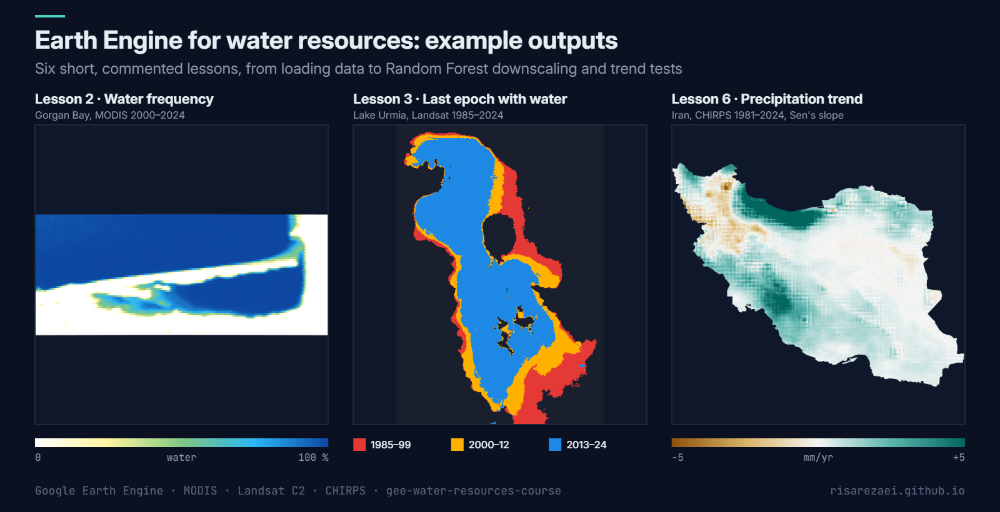

# Earth Engine for Water Resources: a Short Course

Six short, fully commented **Google Earth Engine** lessons for hydrology and water-resources students, from loading your first satellite image to **Random Forest downscaling** and **Mann-Kendall trend tests**. Every script runs as it is: no uploads and no private assets.

Example outputs of lessons 2, 3 and 6.

## Lessons

| # | Script | You will learn | Data |
|---|---|---|---|
| 1 | [`01_data_import.js`](01_data_import.js) | Filtering collections, cloud masking, composites, exporting | Landsat 8/9, HydroBASINS |
| 2 | [`02_water_frequency.js`](02_water_frequency.js) | Mapping functions, NDWI, thresholds, frequency maps | MODIS MOD09A1 |
| 3 | [`03_multitemporal_water.js`](03_multitemporal_water.js) | Harmonising Landsat 5/7/8/9, epoch composites, class maps, areas | Landsat C2 |
| 4 | [`04_soil_moisture_downscaling.js`](04_soil_moisture_downscaling.js) | Stacking predictors, Random Forest regression, R² / RMSE | SMAP, MODIS, SRTM, Sentinel-1 |
| 5 | [`05_water_area_timeseries.js`](05_water_area_timeseries.js) | Time series from image collections, charts, linear trend | MODIS MOD09A1 |
| 6 | [`06_precipitation_trend.js`](06_precipitation_trend.js) | Annual totals, Sen's slope, Mann-Kendall significance | CHIRPS |

## How to use

1. Sign up for [Google Earth Engine](https://earthengine.google.com) (free for research and education).
2. Open the [Code Editor](https://code.earthengine.google.com), create a new script and paste a lesson.
3. Press **Run**. Every lesson ends with an **exercise** to try next.

The study areas are Lake Urmia, Gorgan Bay on the Caspian Sea, and Iran. To use your own area, change the point or rectangle at the top of each script.

## Good practice used throughout

- Filter collections by place and date **before** mapping functions over them.
- Keep dates (`system:time_start`) when you transform images, so later filters still work.
- No `getInfo()` calls: everything stays on the server, so scripts stay fast.
- Collection 2 Landsat scale factors and the current MODIS v061 products.

## Cite this tool

Abbasalizadehrezaei, P. (2026). *Earth Engine for Water Resources: a Short Course* (Version 1.0.0) [Software]. Zenodo. https://doi.org/10.5281/zenodo.23646381

GitHub also offers a ready-made citation under **Cite this repository** (from [CITATION.cff](CITATION.cff)).

## Author

**Parisa Abbasalizadehrezaei** · [risarezaei.github.io](https://risarezaei.github.io)

Released under the [MIT License](LICENSE). Teachers are welcome to reuse and adapt the lessons.
